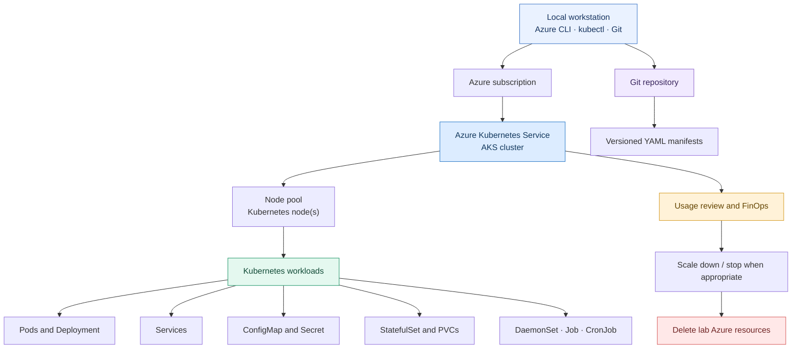
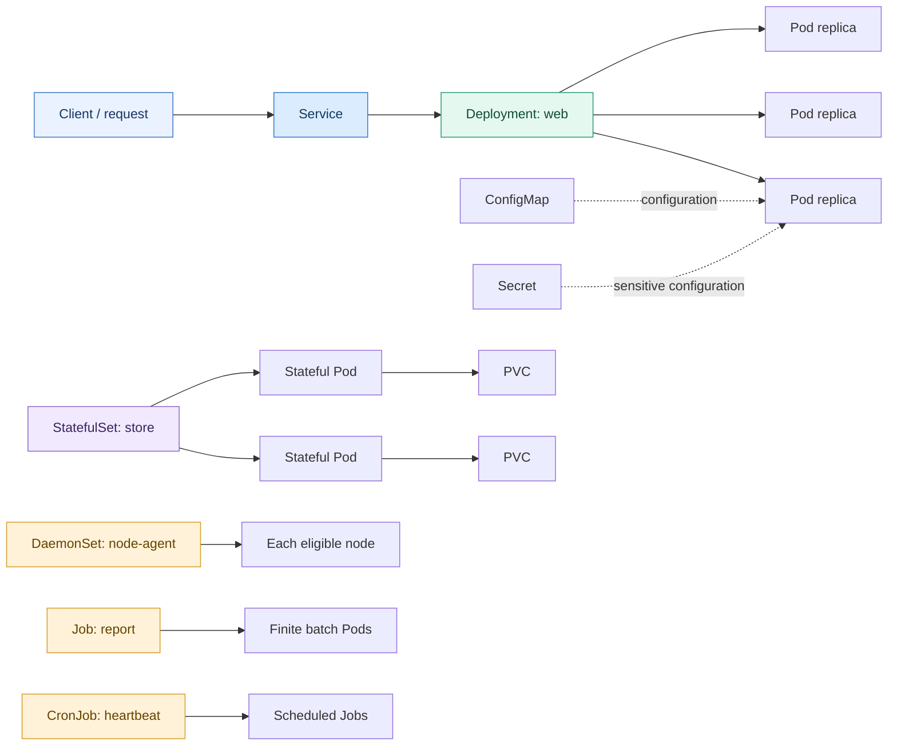

<div align="center">

# Kubernetes on AKS: From Zero to Production Workloads

### A hands-on journey through Azure Kubernetes Service, Kubernetes workloads, observability, FinOps, and clean teardown.

[Start the series](https://dev.to/rahimah_dev/kubernetes-on-aks-from-zero-to-production-workloads-setting-up-the-foundation-part-19-1gpl) · [GitHub repository](https://github.com/rahimahisah17/aks-kubernetes-lab)

</div>

---

## Project overview

This repository documents a practical, nine-part lab series that builds Kubernetes skills on **Azure Kubernetes Service (AKS)**. It starts with a local workspace and Azure tooling, moves through cluster creation and core Kubernetes resources, then finishes with cost awareness, publishing the manifests, and removing the lab infrastructure.

The emphasis is on learning by doing: creating resources, inspecting their behaviour with `kubectl`, keeping YAML manifests under version control, and considering the operational cost of cloud infrastructure.

> **Important:** This is a learning lab, not a production-ready reference architecture. Review security, availability, networking, identity, monitoring, and cost requirements before adapting it for production.

## What this project covers

- Preparing a local workspace and configuring Azure CLI and `kubectl`
- Creating and connecting to an AKS cluster
- Working with Pods and Deployments
- Exposing workloads with Services
- Managing application settings with ConfigMaps and Secrets
- Running stateful workloads with StatefulSets and persistent storage
- Scheduling node-level and batch work with DaemonSets, Jobs, and CronJobs
- Measuring resource usage and exploring cost-optimisation options
- Publishing Kubernetes manifests to GitHub and cleaning up Azure resources

## Architecture at a glance

The lab follows a simple path from local authoring to cloud execution and then cleanup.



## The nine-part learning path

Follow the articles in order. Each part focuses on one stage of the lab.

| Part | Topic | What you will work through |
|---|---|---|
| 1 | [Setting up the foundation](https://dev.to/rahimah_dev/kubernetes-on-aks-from-zero-to-production-workloads-setting-up-the-foundation-part-19-1gpl) | Workspace, tools, Azure sign-in, and initial configuration |
| 2 | [Creating the AKS cluster](https://dev.to/rahimah_dev/kubernetes-on-aks-from-zero-to-production-workloads-creating-the-aks-cluster-part-29-1kf1) | Provisioning the managed Kubernetes cluster and connecting to it |
| 3 | [Pods: the smallest unit](https://dev.to/rahimah_dev/kubernetes-on-aks-from-zero-to-production-workloads-pods-the-smallest-unit-part-39-5d9i) | Creating and inspecting Pods |
| 4 | [Deployments: self-healing and scaling](https://dev.to/rahimah_dev/kubernetes-on-aks-from-zero-to-production-workloads-deployments-self-healing-scaling-and-47po) | Declarative workload management, recovery, and replica scaling |
| 5 | [Services, ConfigMaps, and Secrets](https://dev.to/rahimah_dev/kubernetes-on-aks-from-zero-to-production-workloads-services-configmaps-and-secrets-part-59-2lg3) | Service discovery, connectivity, and application configuration |
| 6 | [StatefulSets and persistent storage](https://dev.to/rahimah_dev/kubernetes-on-aks-from-zero-to-production-workloads-statefulsets-and-persistent-storage-part-27ml) | Stable identities and persistent volume claims |
| 7 | [DaemonSets, Jobs, and CronJobs](https://dev.to/rahimah_dev/kubernetes-on-aks-from-zero-to-production-workloads-daemonsets-jobs-and-cronjobs-part-79-4d8k) | Node-level agents, one-off tasks, and scheduled work |
| 8 | [FinOps: measure, price, and cut cluster costs](https://dev.to/rahimah_dev/kubernetes-on-aks-from-zero-to-production-workloads-finops-measure-price-and-cut-cluster-costs-4be1) | Resource usage, price estimation, scaling, and cost trade-offs |
| 9 | [Publishing to GitHub and cleaning up Azure](https://dev.to/rahimah_dev/kubernetes-on-aks-from-zero-to-production-workloads-publishing-to-github-and-cleaning-up-azure-2fh8) | Versioning the manifests and removing lab infrastructure |

## Workload relationships

This conceptual diagram shows how the core Kubernetes objects in the lab fit together. The exact configuration is defined in the manifests.



## Repository structure

The main deliverable is the collection of Kubernetes YAML manifests and the FinOps report.

```text
aks-kubernetes-lab/
├── manifests/
│   ├── 01-pod.yaml
│   ├── 02-deployment.yaml
│   ├── 03-service-clusterip.yaml
│   ├── 04-service-loadbalancer.yaml
│   ├── 05-configmap.yaml
│   ├── 06-statefulset.yaml
│   ├── 07-daemonset.yaml
│   ├── 08-job.yaml
│   └── 09-cronjob.yaml
└── COST-REPORT.md
```

The manifest filenames are numbered to make the learning sequence easy to follow. The repository also includes a cost review describing the lab configuration, observed utilisation, an indicative VM price, and optimisation actions.

## Example commands

Once your AKS cluster is running and your `kubectl` context points to it, these commands help inspect the environment.

```bash
# Confirm the active Kubernetes context
kubectl config current-context

# Inspect cluster nodes
kubectl get nodes -o wide

# Review workloads in the lab namespace
kubectl get all -n k8s-lab

# Inspect node resource utilisation (requires metrics to be available)
kubectl top nodes

# Inspect pod resource utilisation
kubectl top pods -n k8s-lab

# Review the manifests in this repository
ls manifests/
```

Apply manifests only when the target cluster and namespace are the ones you intend to modify. Some manifests create cloud-facing or persistent resources.

## FinOps and cleanup

Cloud resources can continue to incur charges while they exist, even when application traffic is low. The lab explores usage inspection, node-pool sizing, workload autoscaling, and public LoadBalancer exposure as cost and operational considerations.

The VM price in `COST-REPORT.md` is an **indicative retail-price estimate**, not a confirmed invoice amount. Actual charges can vary with region, usage, disks, networking, public IPs, support plans, and other Azure resources.

After saving the manifests and reports to version control, follow the cleanup article to remove the lab resources. Verify the intended resource group before deleting it: resource-group deletion is destructive and removes the resources contained in that group.

## Skills demonstrated

- Azure Kubernetes Service (AKS)
- Kubernetes resource management with `kubectl`
- YAML manifest authoring and declarative deployments
- Services and in-cluster DNS
- ConfigMaps, Secrets, StatefulSets, and persistent storage
- DaemonSets, Jobs, CronJobs, and autoscaling
- Git and GitHub version control
- Resource utilisation review and cloud cost awareness
- Infrastructure cleanup and cost-conscious lab practices

## Follow the series

Start with [Part 1: Setting up the foundation](https://dev.to/rahimah_dev/kubernetes-on-aks-from-zero-to-production-workloads-setting-up-the-foundation-part-19-1gpl), then work through all nine articles in sequence.

<div align="center">

**Build it. Inspect it. Version it. Optimise it. Clean it up.**

</div>
